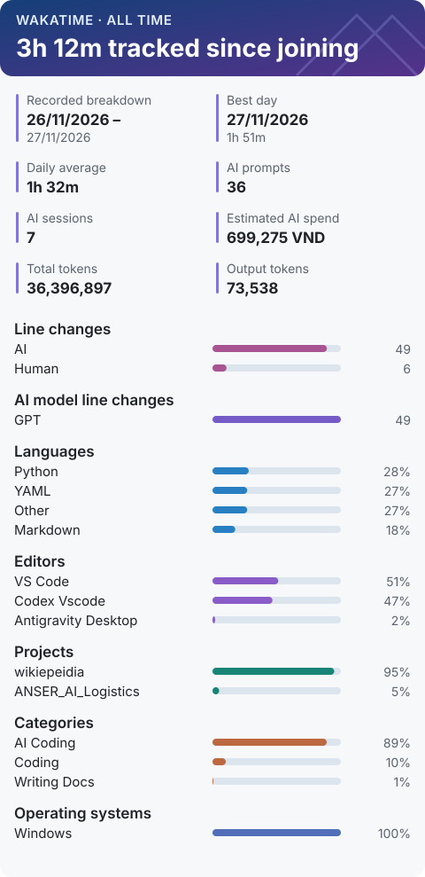

# Hi there 👋

**wikiepeidia/wikiepeidia** is a ✨ _special_ ✨ repository because its `README.md` (this file) appears on your GitHub profile.

Here are some ideas to get you started
-----------

* Profession: ICT student b3& software developer in fpt software
* 🌍  Location: Việt Nam
* 🖥️  See my portfolio at [canva]
* ✉️  You can contact me at [phamtheminh2409@gmail.com](mailto:phamtheminh2409@gmail.com)
* 🧠  I'm currently learning programming and stuffs
* 👥  I'm looking to collaborate on projects

## Quotes

<picture>
  <source media="(prefers-color-scheme: dark)" srcset="https://quotes-github-readme.vercel.app/api?type=horizontal&amp;theme=dark" />
  
</picture>

## GitHub Stats

<table>
<tr><th>GitHub overview</th><th>WakaTime</th></tr>
<tr>
<td width="50%" valign="top">
 

</td>
<td width="50%" valign="top">

</td>
</tr>
<tr><td colspan="2" align="center">
<picture>
  <source srcset="https://raw.githubusercontent.com/wikiepeidia/wikiepeidia/output/pacman-contribution-graph-dark.svg" media="(prefers-color-scheme: dark)" />
  
</picture>
</td></tr>
<tr><td colspan="2" align="center">
<picture>
  <source srcset="https://github-readme-activity-graph.vercel.app/graph?username=wikiepeidia&amp;bg_color=0d1117&amp;color=9be9a8&amp;line=4c8eda&amp;point=38d252&amp;area=true&amp;hide_border=true" media="(prefers-color-scheme: dark)" />
  <source srcset="https://github-readme-activity-graph.vercel.app/graph?username=wikiepeidia&amp;bg_color=ffffff&amp;color=000000&amp;line=9be9a8&amp;point=40c463&amp;area=true&amp;hide_border=true" media="(prefers-color-scheme: light)" />
  
</picture>
</td></tr>
</table>

## Languages and tools

<table>
  <tr><th align="left">Languages</th><td>
    
    
    
    
  </td></tr>
  <tr><th align="left">Frontend</th><td>
    
    
    
  </td></tr>
  <tr><th align="left">Development tools</th><td>
    
    
    
  </td></tr>
  <tr><th align="left">AI tools</th><td>
    
    
    
  </td></tr>
  <tr><th align="left">Operating systems</th><td>
    
    
  </td></tr>
  <tr><th align="left">Database</th><td>
    
    
  </td></tr>
</table>

## Socials

  
  
  
  
  
  
  
  

## Support Me

<table>
  <tr>
    <th>Support online</th>
    <th>Bank transfer</th>
  </tr>
  <tr>
    <td align="center" valign="middle">
      

      
    </td>
    <td align="center">
       
      Scan to transfer · Tap to enlarge
    </td>
  </tr>
</table>
