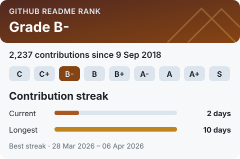

# Hi there 👋

**wikiepeidia/wikiepeidia** is a ✨ _special_ ✨ repository because its `README.md` (this file) appears on your GitHub profile.

Here are some ideas to get you started
-----------

* Profession: ICT student b3& software developer in fpt software
* 🌍  Location: Việt Nam
* 🖥️  See my portfolio at [canva]
* ✉️  You can contact me at [phamtheminh2409@gmail.com](mailto:phamtheminh2409@gmail.com)
* 🧠  I'm currently learning programming and stuffs
* 👥  I'm looking to collaborate on projects

## GitHub Stats

<picture>
  <source srcset="https://raw.githubusercontent.com/wikiepeidia/wikiepeidia/output/pacman-contribution-graph-dark.svg#gh-dark-mode-only" media="(prefers-color-scheme: dark)" />
  <source srcset="https://raw.githubusercontent.com/wikiepeidia/wikiepeidia/output/pacman-contribution-graph.svg#gh-light-mode-only" media="(prefers-color-scheme: light)" />
  
</picture>

## Languages and tools

  
  
  
  
  
  
  
  
  
  
  
  
  
  
  

## Socials

  
  
  
  
  
  
  
  

## Support Me

 

**TechComBank:**

